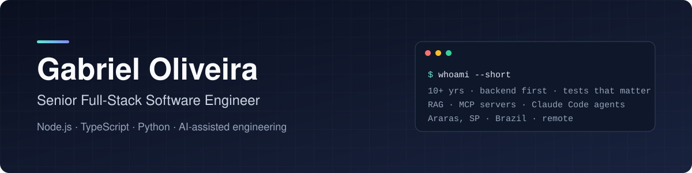

  

Hi, I'm Gabriel. I've been building web software for over ten years, mostly on the backend with Node.js and TypeScript. I care about the parts that make a system easy to trust: good tests, clear docs, and code the next person can change without fear.

Lately I've been working on how AI fits into the way a team builds software. That includes RAG over internal docs, MCP servers, and Claude Code workflows with skills, hooks and agents.

### Stack

### Talk to me

[LinkedIn](https://www.linkedin.com/in/gabrieloliveirath/) · [Email](mailto:gabrieloliveirath@gmail.com)
